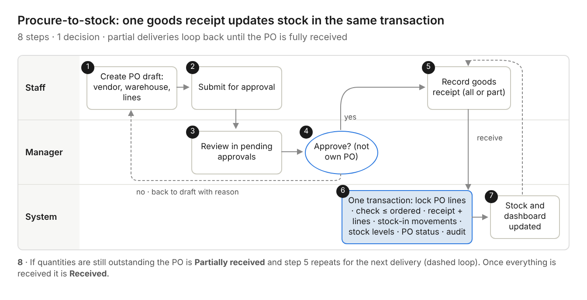
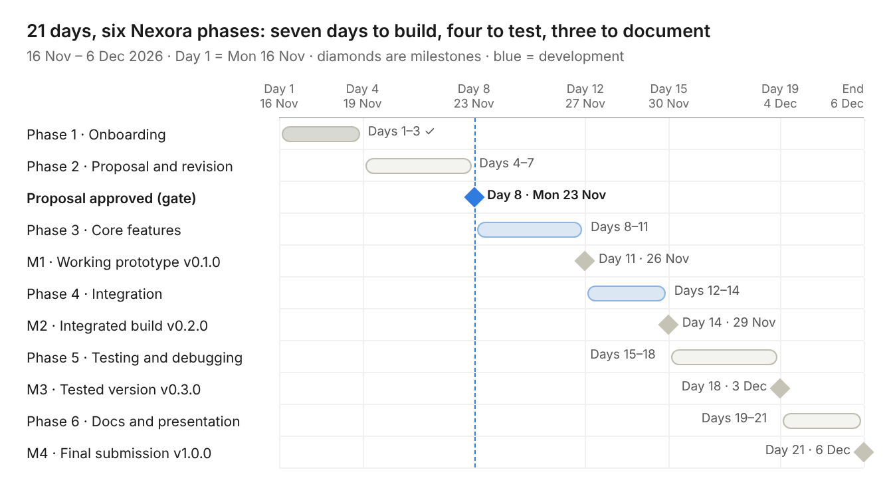

# Nexora ERP — procure-to-stock

A web application that runs the **procure-to-stock** cycle for a small business:

1. Staff raise purchase orders and managers approve them.
2. Goods receipts (full or partial) raise stock in the right warehouse automatically.
3. A dashboard shows what is pending, what is open and what is running low.

It is the first module set of a larger ERP and is built during the Nexora Technologies 21-Day Fullstack Development Internship.

> **Status: Day 5. Revised proposal (Revision 1) submitted for approval.** The first proposal (13 weeks, five modules) was not accepted. This revision fits Nexora's 21-day schedule and narrows the scope to an MVP. No application code is written until management approves the revision.

|               |                                                                                                                         |
| ------------- | ----------------------------------------------------------------------------------------------------------------------- |
| **Programme** | Nexora Technologies 21-Day Fullstack Development Internship (individual project)                                        |
| **Schedule**  | Day 1 = Mon 16 Nov 2026 → Day 21 = Sun 6 Dec 2026. Development Days 8–14, testing Days 15–18, documentation Days 19–21. |
| **Modules**   | Core (users, roles) · Inventory · Procurement · Dashboard and reports                                                   |
| **Stack**     | Next.js 16 · TypeScript · Tailwind CSS + shadcn/ui · Prisma · PostgreSQL 17 · Vitest · Playwright                       |
| **Hosting**   | Vercel (app) + Neon (PostgreSQL)                                                                                        |

## Documents

| Document                                                                           | Contents                                                |
| ---------------------------------------------------------------------------------- | ------------------------------------------------------- |
| [Proposal and system design (PDF)](docs/Nexora-ERP-Proposal-and-System-Design.pdf) | The submission document (Revision 1)                    |
| [Proposal and system design (Markdown)](docs/proposal.md)                          | Same content, readable on GitHub                        |
| [Architecture](docs/architecture.md)                                               | Layers, request lifecycle, workflows, deployment        |
| [Database design and ERD](docs/erd.md)                                             | 12 tables, constraints, design rules, concerns resolved |
| [Architecture decision records](docs/adr/README.md)                                | Why one Next.js app, fixed roles, session cookies       |
| [Contributing guide](CONTRIBUTING.md)                                              | Setup, branching, commits, definition of done           |
| [Changelog](CHANGELOG.md)                                                          | Release notes per milestone                             |
| [Phase reviews](docs/retros.md)                                                    | One entry per Nexora phase                              |

## MVP at a glance

| Module                | Features                                                                                                  |
| --------------------- | --------------------------------------------------------------------------------------------------------- |
| Core                  | Sign-in and sign-out, user management, three roles (Admin, Manager, Staff), audit log                     |
| Inventory             | Products, categories, warehouses, stock levels per warehouse, stock issue and adjustment, movement ledger |
| Procurement           | Vendors, purchase orders with approval (no self-approval), full and partial goods receipts                |
| Dashboard and reports | Pending approvals, open POs, low-stock list and report, CSV export                                        |

Out of scope for the 21 days: Finance, HR and payroll, requisitions, emails, PDFs, multi-currency. See [section 2 of the proposal](docs/proposal.md#2-project-scope-and-boundaries).



## 21-day plan



| Phase             | Days  | Milestone and deliverable                                                          |
| ----------------- | ----- | ---------------------------------------------------------------------------------- |
| 1 · Onboarding    | 1–3   | Acknowledgement form ✓                                                             |
| 2 · Proposal      | 4–7   | Proposal, Revision 1, approval                                                     |
| 3 · Core features | 8–11  | **M1** working prototype `v0.1.0`: sign-in, roles, master data, stock              |
| 4 · Integration   | 12–14 | **M2** integrated build `v0.2.0`: POs, approval, goods receipts → stock, dashboard |
| 5 · Testing       | 15–18 | **M3** tested version `v0.3.0` and testing report                                  |
| 6 · Documentation | 19–21 | **M4** final report, user manual, presentation, `v1.0.0`                           |

The day-by-day plan is in [section 10 of the proposal](docs/proposal.md#103-day-by-day-implementation-plan).

## Getting started

Requires Node.js 24 (see `.nvmrc`), pnpm 9 through Corepack, and Docker.

```bash
git clone https://github.com/naitik-raj17/nexora-erp-naitik-raj.git
cd nexora-erp-naitik-raj
corepack enable && pnpm install
cp .env.example .env
docker compose up -d      # PostgreSQL 17
pnpm db:migrate           # applies prisma/migrations
pnpm dev                  # http://localhost:3000
```

Other scripts: `pnpm lint`, `pnpm typecheck`, `pnpm test`, `pnpm build`, `pnpm db:studio`. `GET /api/health` reports app and database status.

The seed script and demo accounts (one per role) arrive on Day 9.

## Repository structure

```
├── src/                 # Next.js app: app/, components/, server/ (service layer), lib/
├── prisma/              # schema.prisma and migrations; seed.ts from Day 9
├── tests/               # unit/ (Vitest) and e2e/ (Playwright)
├── docs/                # proposal, architecture, ERD, ADRs, images; later the testing report, final report, user manual
├── .github/             # CI, CodeQL, Dependabot, PR and issue templates
├── docker-compose.yml   # local PostgreSQL 17
└── .env.example
```

## Author

**Naitik Raj** · [@naitik-raj17](https://github.com/naitik-raj17) · Application ID NXT-2026-01184
