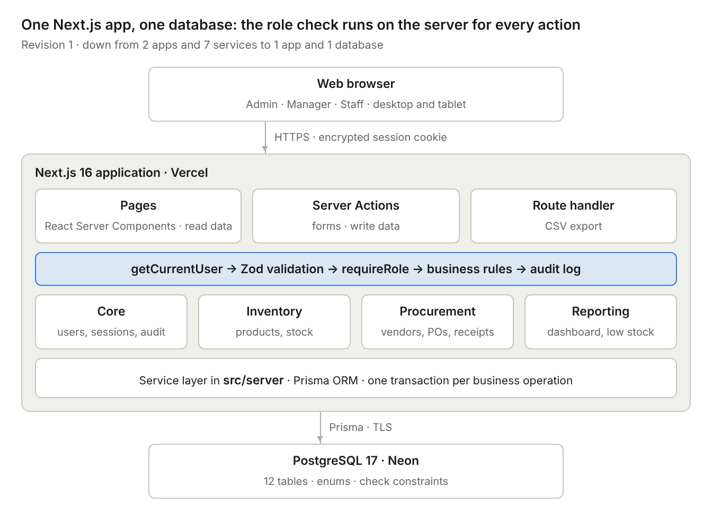
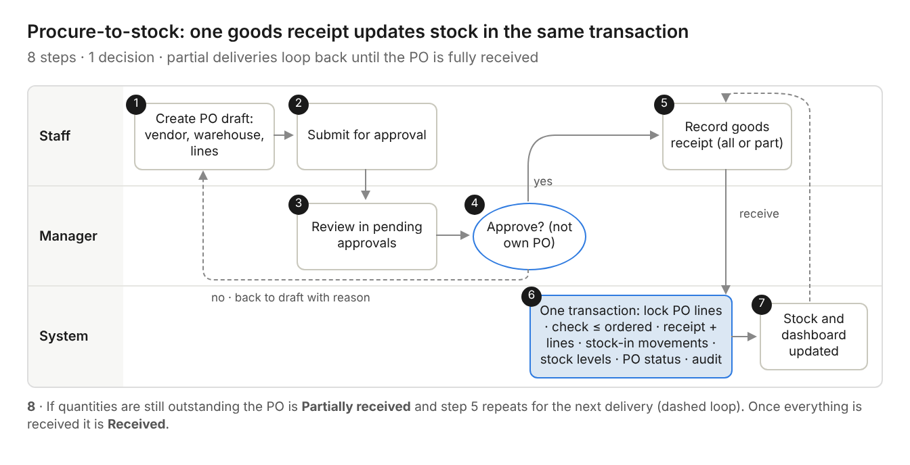

# System architecture

Nexora ERP is **one Next.js application with one PostgreSQL database**. Pages read data on the server, forms call Server Actions, and every write goes through the same chain: session check, input validation, role check, business rules, transaction and audit log.



## Components

| Component      | Technology                                          | Responsibility                                                                        |
| -------------- | --------------------------------------------------- | ------------------------------------------------------------------------------------- |
| Pages          | Next.js 16 App Router, React Server Components      | Read data through the service layer and render tables and forms                       |
| Server Actions | Next.js Server Actions                              | Thin wrappers: get the user, validate with Zod, call one service function, revalidate |
| Route handler  | `src/app/api/export/[report]/route.ts`              | CSV export                                                                            |
| Service layer  | `src/server/{core,inventory,procurement,reporting}` | Business rules, role checks, transactions. Unit-tested without Next.js.               |
| Data access    | Prisma 6                                            | Typed queries, migrations, and raw SQL for constraints and atomic stock updates       |
| Database       | PostgreSQL 17 (Docker locally, Neon in production)  | 12 tables, 5 enums, check constraints                                                 |
| Session        | iron-session (encrypted httpOnly cookie) + bcryptjs | Sign-in. The user is reloaded from the database on every request.                     |

## Module boundaries

- Each module's service functions are the only code that writes its tables.
- Procurement calls one Inventory function, `applyReceiptMovements(tx, lines)`, and passes it its open transaction. A goods receipt and its stock changes therefore commit or roll back together.
- Reporting only reads.

## Request lifecycle (every write)

1. The form submits and a Server Action runs on the server.
2. `getCurrentUser()` decrypts the session cookie and loads the user. A missing or inactive user is sent to sign-in.
3. A Zod schema validates the input. If it fails, field errors go back to the form.
4. The service checks the role (`requireRole(user, 'MANAGER', 'ADMIN')`) and the business rules, then writes inside `prisma.$transaction`, including the audit log row.
5. `revalidatePath()` refreshes the affected pages.

## Workflows

### Procure to stock



The goods receipt transaction:

1. Lock the PO lines with `SELECT ... FOR UPDATE`.
2. Check that received plus this receipt is not more than ordered, for every line.
3. Insert the receipt and its lines.
4. Insert one RECEIPT stock movement per line.
5. Add each quantity to `stock_levels` with an upsert.
6. Set the PO to `PARTIALLY_RECEIVED` or `RECEIVED`.
7. Insert the audit log row.

### Stock issue and adjustment

The movement is inserted and stock changes with one conditional statement:

```sql
UPDATE stock_levels SET on_hand = on_hand + $delta, updated_at = now()
WHERE product_id = $1 AND warehouse_id = $2 AND on_hand + $delta >= 0;
```

If no row is updated, the action fails with "Insufficient stock" and the transaction rolls back.

### PO approval

`SUBMITTED → APPROVED` sets `approved_by_id` and `approved_at`. The service rejects approval by the PO's creator, and the database constraint `approved_by_id <> created_by_id` also blocks it. `SUBMITTED → DRAFT` (rejection) stores the reason in the audit log.

## Deployment

| Environment | App                                 | Database                     | Trigger                        |
| ----------- | ----------------------------------- | ---------------------------- | ------------------------------ |
| Local       | `pnpm dev`                          | Docker Compose PostgreSQL 17 | Manual                         |
| Preview     | Vercel preview URL per pull request | Neon branch database         | Pull request opened or updated |
| Production  | Vercel                              | Neon (main branch)           | Merge to `main`                |

Related decisions: [ADR 0004](adr/0004-single-nextjs-app.md) and [ADR 0005](adr/0005-fixed-roles-and-session-auth.md).
