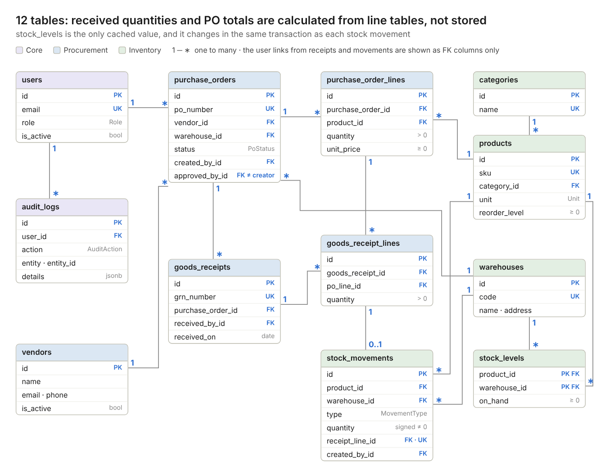
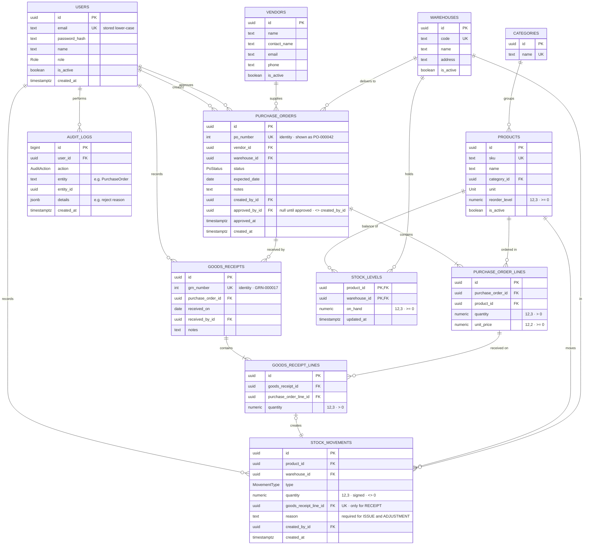

# Database design and ERD

## Overview

One PostgreSQL 17 database with **12 tables and 5 enums**, in third normal form. There is one deliberate exception: `stock_levels` caches the sum of `stock_movements` so that stock pages are fast (rule D7).

| Module      | Tables                                                                                        |
| ----------- | --------------------------------------------------------------------------------------------- |
| Core        | `users`, `audit_logs`                                                                         |
| Inventory   | `categories`, `products`, `warehouses`, `stock_movements`, `stock_levels`                     |
| Procurement | `vendors`, `purchase_orders`, `purchase_order_lines`, `goods_receipts`, `goods_receipt_lines` |

**Enums:** `Role` (ADMIN, MANAGER, STAFF) · `PoStatus` (DRAFT, SUBMITTED, APPROVED, PARTIALLY_RECEIVED, RECEIVED, CANCELLED) · `MovementType` (RECEIPT, ISSUE, ADJUSTMENT) · `AuditAction` (CREATED, SUBMITTED, APPROVED, REJECTED, RECEIVED, CANCELLED, ADJUSTED) · `Unit` (PCS, BOX, KG, LITRE, METRE)

## Design rules

| #   | Rule                | Detail                                                                                                                                                                                                                                                                                                                |
| --- | ------------------- | --------------------------------------------------------------------------------------------------------------------------------------------------------------------------------------------------------------------------------------------------------------------------------------------------------------------- |
| D1  | Keys                | UUID primary keys generated by Prisma (`@default(uuid())`). Documents also get an identity-column number (`po_number`, `grn_number`) for display. PostgreSQL issues these numbers, so two users saving at the same moment never collide.                                                                              |
| D2  | Numbers             | `NUMERIC(12,2)` for money and `NUMERIC(12,3)` for quantities. The app uses Prisma's `Decimal` type, never JavaScript floats.                                                                                                                                                                                          |
| D3  | Statuses            | PostgreSQL enums, not free text, so an invalid status cannot be stored                                                                                                                                                                                                                                                |
| D4  | Line tables         | A PO total is calculated from its lines (`SUM(quantity * unit_price)`), not stored, so it cannot drift from the lines                                                                                                                                                                                                 |
| D5  | Received quantity   | Calculated as `SUM(goods_receipt_lines.quantity)` per PO line, not stored on the PO line. The receipt service locks the PO lines (`SELECT ... FOR UPDATE`) before checking that received quantity will not exceed ordered quantity.                                                                                   |
| D6  | Movement ledger     | `stock_movements` is append-only (insert, never update or delete). A mistake is fixed with a new adjustment.                                                                                                                                                                                                          |
| D7  | Stock levels        | `stock_levels.on_hand` is the only stored derived value. It changes only in the same transaction as the movement, through one conditional `UPDATE`, and `CHECK (on_hand >= 0)` is the final safeguard. An integration test checks that `on_hand` equals the sum of movements for every product and warehouse.         |
| D8  | Constraints         | Check constraints for positive quantities, non-negative prices and reorder levels, `approved_by_id <> created_by_id`, and "a movement of type RECEIPT has a goods_receipt_line_id; ISSUE and ADJUSTMENT have a reason". Prisma cannot express check constraints, so they are added as raw SQL in the first migration. |
| D9  | No hard deletes     | Master data has `is_active` instead of being deleted, so unique keys (SKU, warehouse code, email) stay simple and documents keep their history                                                                                                                                                                        |
| D10 | Indexes             | Every foreign key; `purchase_orders(status)`; `stock_movements(product_id, created_at)`; `products(name)` for search                                                                                                                                                                                                  |
| D11 | Migrations and seed | Versioned Prisma migrations committed to Git. `prisma/seed.ts` creates three demo users (one per role), categories, 3 warehouses, 20 vendors, 200 products and 100 POs in mixed statuses.                                                                                                                             |

## Concerns in the first design and how this revision resolves them

| #   | Concern in the first proposal                                                                                                                                                | Resolution in this revision                                                                                                                                             |
| --- | ---------------------------------------------------------------------------------------------------------------------------------------------------------------------------- | ----------------------------------------------------------------------------------------------------------------------------------------------------------------------- |
| 1   | **Too many tables for the time available:** 29 tables across five modules (the overview diagram said 27)                                                                     | 12 tables in three modules, all listed above and checked against the Prisma schema on Day 8                                                                             |
| 2   | **Partial receipts could not be traced.** `received_qty` was stored on `PO_LINE` and goods receipts had no lines, so no one could tell which receipt brought which quantity. | New `goods_receipt_lines` table. Received quantity is derived from it (D5), and each receipt line links to exactly one stock movement.                                  |
| 3   | **Over-receipt and lost updates.** Two receipts saved at the same time could both pass the "not more than ordered" check.                                                    | PO lines are locked with `SELECT ... FOR UPDATE` inside the receipt transaction (D5)                                                                                    |
| 4   | **Negative stock under concurrency.** A read-then-write update of `STOCK_LEVEL` could oversell.                                                                              | A single conditional `UPDATE` plus `CHECK (on_hand >= 0)` (D7; see [architecture](architecture.md#stock-issue-and-adjustment))                                          |
| 5   | **Transfers could not be modelled.** `STOCK_MOVEMENT` had one warehouse but a `transfer` type.                                                                               | Transfers removed from the Must scope. FR-18 (Could) records one as a linked issue and receipt, so each movement still has exactly one warehouse.                       |
| 6   | **"Third normal form" was claimed, but derived values were stored** (`PO total`, `received_qty`, `avg_cost`, invoice totals with no line tables)                             | Totals and received quantities are calculated (D4, D5). Weighted average cost is dropped. The one cached value, `on_hand`, is documented and reconciled by a test (D7). |
| 7   | **A double-entry "database check" that a CHECK constraint cannot enforce** (a sum across rows)                                                                               | Accounting is out of scope. The future Finance phase will use a deferred constraint trigger.                                                                            |
| 8   | **Polymorphic payments.** `PAYMENT` had a nullable `invoice_id` and a nullable `bill_id` with nothing to stop both or neither being set.                                     | Removed with Finance. The future design note is separate tables, or `CHECK (num_nonnulls(invoice_id, bill_id) = 1)`.                                                    |
| 9   | **Circular foreign key** between `DEPARTMENT.manager_id` and `EMPLOYEE.department_id`                                                                                        | Removed with HR and departments                                                                                                                                         |
| 10  | **Soft delete conflicted with unique keys.** A `deleted_at` row still held its SKU or email, so the same SKU could not be re-created.                                        | `is_active` flag and no deletes (D9)                                                                                                                                    |
| 11  | **Statuses as free strings; UUID v7 assumed to be native.** PostgreSQL 17 has no built-in UUID v7 function.                                                                  | PostgreSQL enums (D3). Prisma generates UUIDs in the application, so no database extension is needed (D1).                                                              |
| —   | **Audit columns on every table** pointed `created_by` and `updated_by` at `USER` from all 29 tables                                                                          | `created_by_id` only where it matters (POs, receipts, movements), plus one `audit_logs` table for document actions                                                      |

The Prisma schema (`prisma/schema.prisma`, written on Day 8) follows this document exactly. Any change to the schema updates this file in the same pull request.
