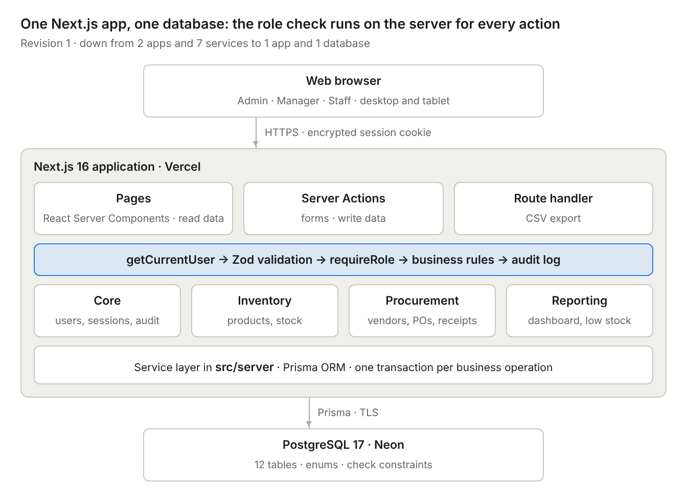
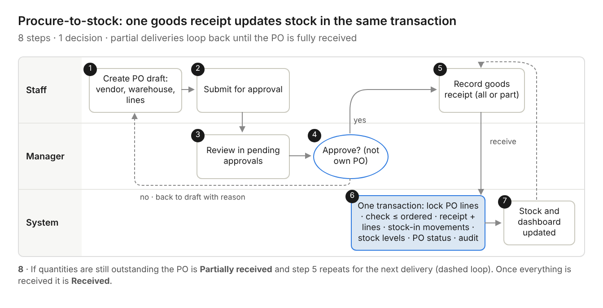
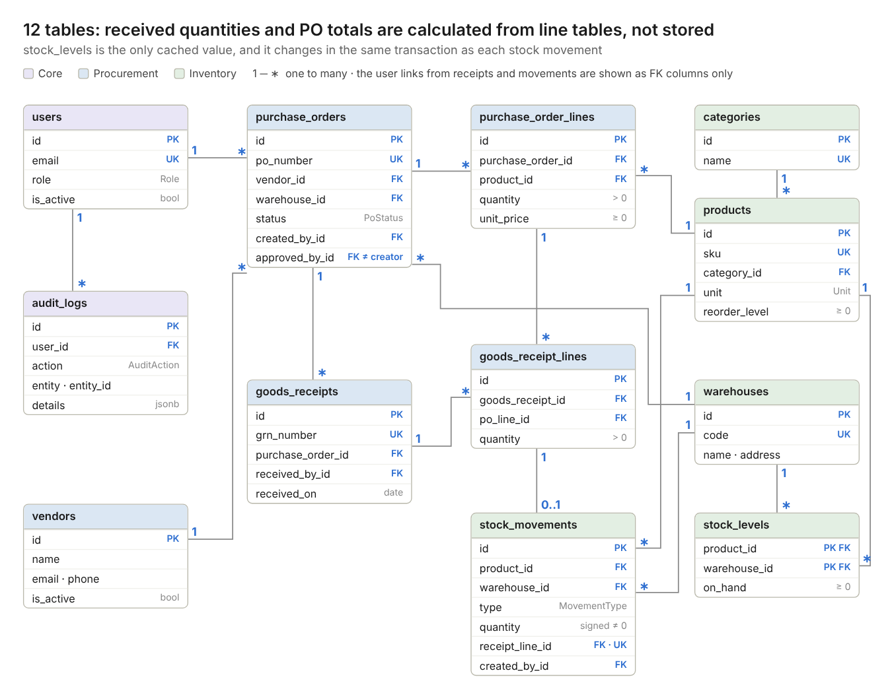
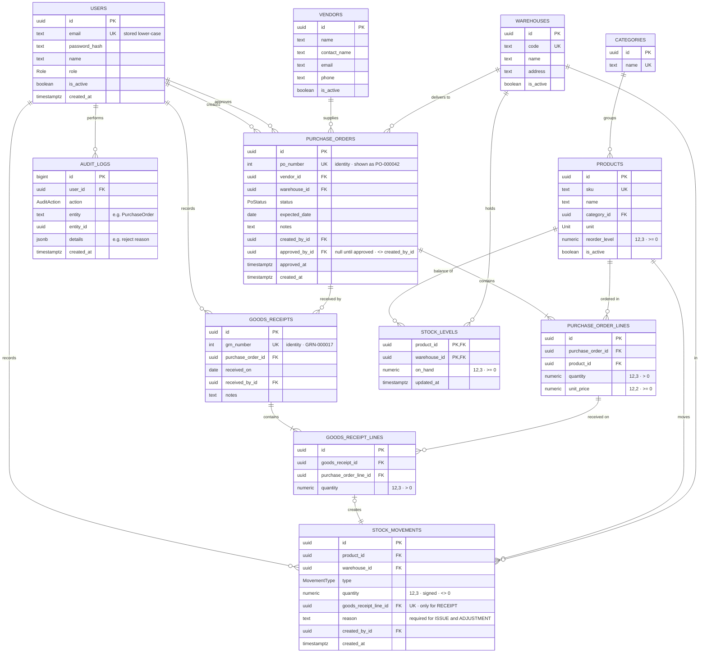
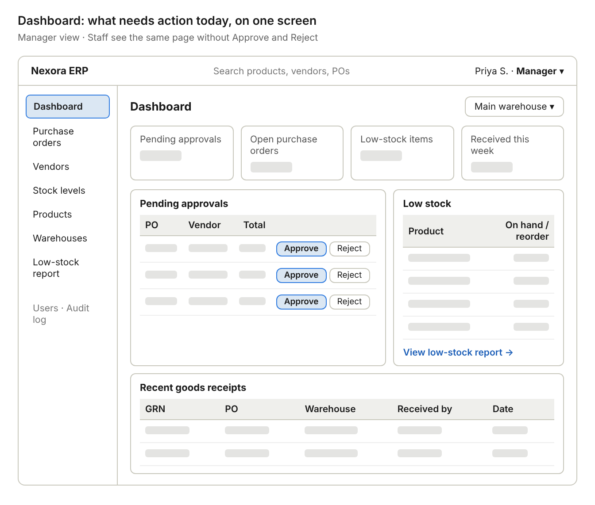
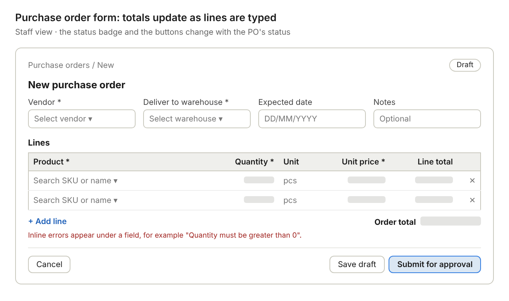
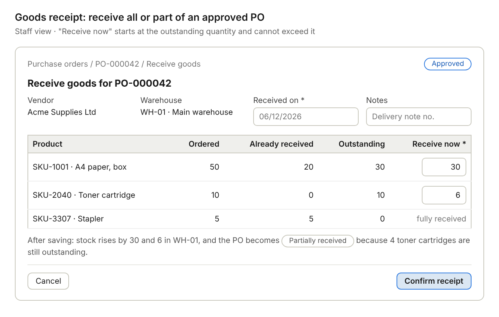
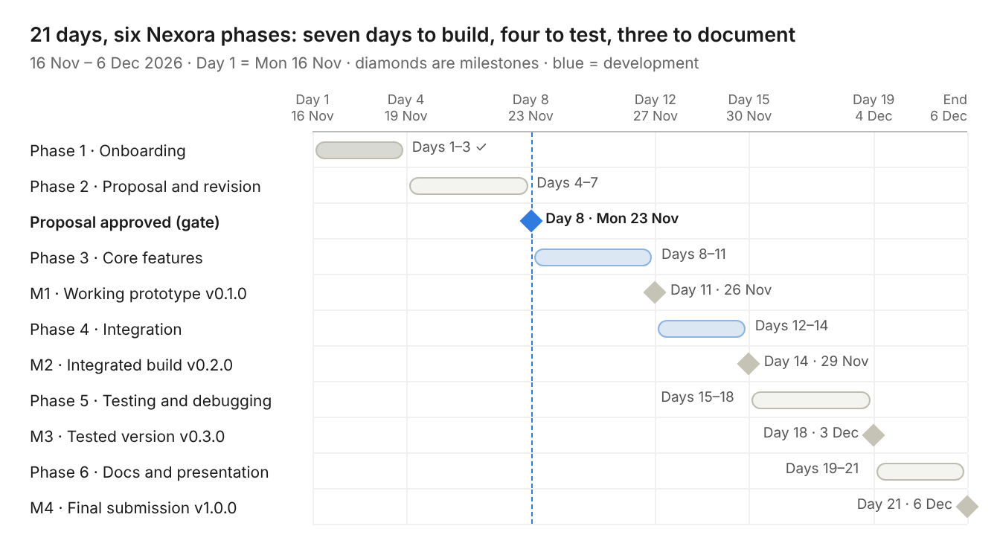

# Nexora ERP — Project Proposal & System Design (Revision 1)

20 November 2026 (Day 5) · Naitik Raj · Application ID NXT-2026-01184 · Nexora Technologies 21-Day Fullstack Development Internship

> **Revision 1** replaces the version submitted on 19 November 2026, which was not accepted. Section 0 maps each change management asked for to the section that addresses it.

## 0. Revision summary

The first proposal planned a five-module ERP over 13 weeks. This revision fits Nexora's official 21-day schedule. It narrows the build to one end-to-end business flow, **procure-to-stock**, which can be built, tested and documented in the seven development days (Day 8 to Day 14) and four testing days (Day 15 to Day 18) the programme allows.

| #   | Revision requested by management                               | What changed                                                                                                                                                                                                 | Section |
| --- | -------------------------------------------------------------- | ------------------------------------------------------------------------------------------------------------------------------------------------------------------------------------------------------------ | ------- |
| 1   | Replace the 13-week timeline with the official 21-day schedule | The plan follows Nexora's six phases and their deadlines (Day 3, 7, 11, 14, 18 and 21). Sprints and dates beyond 6 December are removed.                                                                     | 10      |
| 2   | Reduce and prioritise scope into a realistic MVP               | Five modules become three plus a dashboard. Finance, HR and payroll are out of scope. Requirements drop from 22 to 18 and every one has a priority. Fixed cut lines say what is dropped first if work slips. | 2, 3    |
| 3   | Clearly identify core modules and features                     | Core (sign-in, users, roles), Inventory, Procurement and Dashboard, each with a short feature list                                                                                                           | 4       |
| 4   | Detailed implementation plan with milestones and deliverables  | A day-by-day plan from Day 8 to Day 21 with four milestones (M1 to M4) that match Nexora's phase deliverables, plus exit criteria for each                                                                   | 10      |
| 5   | Reassess the technology stack and justify it for 21 days       | Two apps (Next.js + NestJS) with seven infrastructure services become one Next.js app and one PostgreSQL database. Every dropped tool is listed with the reason.                                             | 6       |
| 6   | Address database design and implementation concerns            | 29 tables become 12. Eleven concerns are listed with how each is resolved (section 8.3).                                                                                                                     | 8       |
| 7   | Align final deliverables with Nexora's requirements            | Every item in Nexora's final deliverables and mandatory submission list is mapped to a file, a day and a format                                                                                              | 12      |

## 1. Project overview and objectives

**Problem.** Small businesses that buy and stock goods usually track purchase orders in spreadsheets or email and track stock in a separate sheet. Nobody can say with confidence what has been ordered, what has arrived or what is about to run out. Approval of spending is informal, and stock figures drift because receipts are typed in twice.

**Solution.** Nexora ERP is a web application that runs the **procure-to-stock** cycle in one place:

1. Staff raise a purchase order.
2. A manager approves it.
3. When goods arrive, the receipt automatically raises stock in the right warehouse.
4. A dashboard shows what is pending, what is low and what is on hand.

The application is built as the first module set of a larger ERP. Finance and HR are left for later phases.

**Objectives (all achievable by Day 21)**

1. Deliver one secured web application with three roles (Admin, Manager, Staff), enforced on the server.
2. Manage products, warehouses and vendors, and keep accurate stock levels per warehouse through a stock movement ledger.
3. Run purchase orders through draft, approval and receipt. Partial deliveries are supported, and nobody can approve their own order.
4. Make every goods receipt update stock in the same database transaction, so stock can never disagree with receipts.
5. Show managers a dashboard of pending approvals, open orders and low-stock items.
6. Submit a tested, documented and deployed application with a testing report, final report, user manual and presentation, as Nexora requires.

**Success criteria (checked on Day 18 and Day 21)**

- Every Must requirement in section 3 passes its acceptance test, recorded in the testing report.
- The procure-to-stock flow (create PO → approve → receive partially → receive the rest → stock updated) passes an automated end-to-end test.
- The live demo works with seeded data (at least 200 products, 3 warehouses, 20 vendors and 100 purchase orders), and list pages load in under 2 seconds.
- At least 70% line coverage on the service layer (`src/server`), where all business rules live.

## 2. Project scope and boundaries

**MVP boundary:** one company, one currency, three fixed roles, and the procure-to-stock flow from purchase order to stock on hand. Anything that does not serve that flow is out of scope for the 21 days.

| In scope (MVP, Day 8 to Day 14)                                                 | Out of scope (future phases, after the internship)                                                                                    |
| ------------------------------------------------------------------------------- | ------------------------------------------------------------------------------------------------------------------------------------- |
| Sign-in, sign-out, user management by an Admin                                  | Self-registration, password reset by email, single sign-on                                                                            |
| Three fixed roles: Admin, Manager, Staff                                        | Configurable roles and a permission editor                                                                                            |
| Products, categories, warehouses, vendors                                       | Barcodes, product variants, multiple units of measure                                                                                 |
| Stock levels per warehouse; stock issues and adjustments with a movement ledger | Stock transfers between warehouses, batch and serial tracking, stock valuation methods                                                |
| Purchase orders with approval; full and partial goods receipts                  | Requisitions, requests for quotation, vendor portal, emailing POs to vendors                                                          |
| Dashboard, low-stock report, CSV export                                         | Custom reports, charts over time, PDF generation                                                                                      |
| Responsive web app (desktop and tablet, 768 px and up)                          | Native mobile apps, offline mode                                                                                                      |
| —                                                                               | **Finance** (ledger, invoices, bills, payments) and **HR** (employees, leave, payroll), the two largest modules of the first proposal |

**Assumptions**

- I work on the project individually, in an individual public repository, as Nexora's GitHub requirements state.
- All demo data is synthetic. No real company or personal data is used.
- Money is recorded, not processed. There is no payment gateway, tax engine or accounting.
- About six focused hours a day are available for each of Days 8 to 21.

## 3. Functional and non-functional requirements

Priorities use MoSCoW. **Must** items make up the MVP and are built by Day 14. **Should** items are built if their day's Must work is finished. **Could** items are only built in leftover time on Day 17. Every Must item has an acceptance test in the testing report.

### 3.1 Functional requirements

| ID    | Module      | Requirement                                                                                                                                                                  | Priority | Built on |
| ----- | ----------- | ---------------------------------------------------------------------------------------------------------------------------------------------------------------------------- | -------- | -------- |
| FR-01 | Core        | Users sign in with email and password and sign out. Deactivated users cannot sign in, and their existing sessions stop working.                                              | Must     | Day 9    |
| FR-02 | Core        | An Admin creates users, assigns one of three roles, and deactivates or reactivates them                                                                                      | Must     | Day 9    |
| FR-03 | Core        | Every page and every server action checks the user's role on the server. The UI also hides actions the role cannot take.                                                     | Must     | Day 9    |
| FR-04 | Inventory   | Manage products (SKU, name, category, unit, reorder level, active flag) with search and pagination                                                                           | Must     | Day 10   |
| FR-05 | Inventory   | Manage warehouses and product categories                                                                                                                                     | Must     | Day 10   |
| FR-06 | Procurement | Manage vendors (name, contact, email, phone, active flag)                                                                                                                    | Must     | Day 10   |
| FR-07 | Inventory   | Show stock on hand per product per warehouse                                                                                                                                 | Must     | Day 11   |
| FR-08 | Inventory   | Record a stock issue (goods out) or a stock adjustment with a reason. Stock can never go below zero.                                                                         | Must     | Day 11   |
| FR-09 | Inventory   | Show the movement history (ledger) for a product, filterable by warehouse and date                                                                                           | Must     | Day 11   |
| FR-10 | Procurement | Create a purchase order (vendor, delivery warehouse, lines of product, quantity and unit price), save it as a draft and submit it for approval                               | Must     | Day 12   |
| FR-11 | Procurement | A Manager or Admin approves or rejects a submitted PO. A rejected PO returns to draft with a reason. Nobody approves their own PO.                                           | Must     | Day 12   |
| FR-12 | Procurement | Record a goods receipt against an approved PO, in full or in part. Received quantities raise stock in the PO's warehouse, and the PO becomes Partially received or Received. | Must     | Day 13   |
| FR-13 | Reporting   | Dashboard with counts of pending approvals, open POs and low-stock items, plus a pending-approvals list and a low-stock list                                                 | Must     | Day 14   |
| FR-14 | Reporting   | Low-stock report: products whose total on hand is at or below their reorder level                                                                                            | Must     | Day 14   |
| FR-15 | Core        | Audit log of document actions (PO submitted, approved, rejected, received, cancelled; stock adjusted), viewable by Admin and Manager                                         | Should   | Day 13   |
| FR-16 | Procurement | Cancel a PO that has nothing received yet                                                                                                                                    | Should   | Day 12   |
| FR-17 | Reporting   | Export stock levels and the PO list to CSV                                                                                                                                   | Should   | Day 14   |
| FR-18 | Inventory   | Transfer stock between warehouses (recorded as a linked issue and receipt)                                                                                                   | Could    | Day 17   |

### 3.2 Non-functional requirements

Each item states how it is checked, so it can be tested rather than only promised.

| ID     | Category        | Requirement                                                                                                                                                         | How it is checked                                         |
| ------ | --------------- | ------------------------------------------------------------------------------------------------------------------------------------------------------------------- | --------------------------------------------------------- |
| NFR-01 | Security        | Passwords hashed with bcrypt (cost 12). Session in an encrypted, httpOnly, Secure, SameSite=Lax cookie. Sign-in is rate-limited to 5 attempts per minute per email. | Unit tests; manual check of cookie flags                  |
| NFR-02 | Authorisation   | Role checks run on the server in every page and server action, never only in the UI                                                                                 | An automated test calls each server action with each role |
| NFR-03 | Data integrity  | Every operation that changes stock or document status runs in one database transaction. Database constraints block negative stock, over-receipt and self-approval.  | Unit and integration tests, including concurrent receipts |
| NFR-04 | Validation      | All input validated with Zod on the server; the same schemas give inline form errors                                                                                | Unit tests on schemas                                     |
| NFR-05 | Performance     | List pages paginated (25 rows) and load in under 2 seconds on the deployed demo with seeded data                                                                    | Timed during Day 17 testing                               |
| NFR-06 | Usability       | Works from 768 px wide. Labelled form fields, keyboard navigation and visible focus states.                                                                         | Manual checklist in the testing report                    |
| NFR-07 | Maintainability | TypeScript strict mode, ESLint and Prettier. Business rules sit in a service layer separate from the UI.                                                            | CI on every pull request                                  |
| NFR-08 | Portability     | `docker compose up -d`, `pnpm db:migrate`, `pnpm db:seed` and `pnpm dev` run the whole app locally                                                                  | Verified from a fresh clone on Day 19                     |

## 4. System modules and key features

The MVP has four modules. Each is a folder in the service layer with its own functions and tests, and the modules talk to each other only through those functions.

| Module                    | Purpose              | Key features                                                                                | Requirements                        |
| ------------------------- | -------------------- | ------------------------------------------------------------------------------------------- | ----------------------------------- |
| **Core**                  | Who can do what      | Sign-in and sign-out, sessions, user management, role guard, audit log                      | FR-01 to FR-03, FR-15               |
| **Inventory**             | What stock is where  | Products, categories, warehouses, stock levels, stock issue and adjustment, movement ledger | FR-04, FR-05, FR-07 to FR-09, FR-18 |
| **Procurement**           | Buy under control    | Vendors, purchase orders, approval, goods receipts (full and partial), cancellation         | FR-06, FR-10 to FR-12, FR-16        |
| **Dashboard and reports** | What needs attention | KPI cards, pending approvals, low-stock list and report, CSV export                         | FR-13, FR-14, FR-17                 |

**The one integration that matters.** A goods receipt (Procurement) creates stock-in movements and updates stock levels (Inventory) inside the same transaction. This is the cross-module flow the project demonstrates, and it gets the most test coverage.

**Purchase order status flow**

```
Draft ──submit──▶ Submitted ──approve──▶ Approved ──receive part──▶ Partially received ──receive rest──▶ Received
  ▲                   │                     │                              │
  └────reject─────────┘                     └──────────receive all────────────────────────────────────▶ Received
Draft / Submitted / Approved (nothing received) ──cancel──▶ Cancelled
```

## 5. User roles and permissions

Three fixed roles, stored as a PostgreSQL enum on the user. Fixed roles replace the first proposal's eight roles with configurable permissions: they cover the procure-to-stock flow, keep authorisation easy to test, and remove four tables.

| Role        | Who                              | Main responsibilities                                                                                   |
| ----------- | -------------------------------- | ------------------------------------------------------------------------------------------------------- |
| **Admin**   | System owner                     | Manages users. Full access to all data. Can approve POs raised by others.                               |
| **Manager** | Operations or purchasing manager | Approves or rejects POs, maintains vendors and products, adjusts stock, views reports and the audit log |
| **Staff**   | Buyer or storekeeper             | Raises and submits POs, records goods receipts and stock issues, and views stock and reports            |

**Permission matrix** (C = create, R = read, U = update, A = approve or reject; "own" = only documents the user created)

| Feature                                               | Admin           | Manager     | Staff                     |
| ----------------------------------------------------- | --------------- | ----------- | ------------------------- |
| Users                                                 | CRU, deactivate | —           | —                         |
| Products, categories, warehouses                      | CRU             | CRU         | R                         |
| Vendors                                               | CRU             | CRU         | R                         |
| Purchase orders: create, edit draft, submit           | CRU             | CRU         | CRU (own)                 |
| Purchase orders: approve or reject                    | A (not own)     | A (not own) | —                         |
| Purchase orders: cancel                               | U               | U           | U (own, not yet approved) |
| Goods receipts                                        | CR              | CR          | CR                        |
| Stock issue                                           | C               | C           | C                         |
| Stock adjustment                                      | C               | C           | —                         |
| Dashboard, stock levels, low-stock report, CSV export | R               | R           | R                         |
| Audit log                                             | R               | R           | —                         |

**Rules enforced on the server and in the database**

- Nobody approves a PO they created. The service checks this, and the database also enforces it with a `CHECK (approved_by_id <> created_by_id)` constraint.
- A deactivated user is signed out on their next request, because every request reloads the user's role and active flag from the database.
- Records are never hard-deleted once a document refers to them. They are deactivated instead.

## 6. Technology stack and development tools

### 6.1 Selected stack

**One Next.js application, one PostgreSQL database, TypeScript throughout.** One codebase, one deployment and one language mean that most of the seven build days go into features rather than plumbing.

| Layer                | Technology                                                                                   | Why it suits a 21-day build                                                                                                                                                                               |
| -------------------- | -------------------------------------------------------------------------------------------- | --------------------------------------------------------------------------------------------------------------------------------------------------------------------------------------------------------- |
| Framework            | **Next.js 16 (App Router), React 19, TypeScript 5**                                          | UI and server logic in one app. Server Components read data directly and Server Actions handle writes, so no separate API layer, client data-fetching library or CORS setup is needed.                    |
| UI                   | **Tailwind CSS 4, shadcn/ui**                                                                | Ready-made accessible components (tables, forms, dialogs, badges) copied into the repo. Screens are assembled rather than designed from scratch.                                                          |
| Forms and validation | **React Hook Form, Zod**                                                                     | One Zod schema per form checks input on the server and shows inline errors in the browser                                                                                                                 |
| Database             | **PostgreSQL 17**                                                                            | ACID transactions, enums, check constraints and row locking. Stock and receipts need these to stay consistent.                                                                                            |
| ORM and migrations   | **Prisma 6**                                                                                 | The schema file doubles as living ERD documentation, the client is type-safe, and migrations are versioned. Raw SQL is used where Prisma cannot express a rule (check constraints, atomic stock updates). |
| Authentication       | **bcryptjs + iron-session**                                                                  | Email and password sign-in in about 150 lines of code that I can fully explain and test. No external identity provider or extra auth tables.                                                              |
| Testing              | **Vitest** (unit and integration against a test database), **Playwright** (end-to-end)       | Vitest is fast and needs little configuration for TypeScript. Playwright runs the three critical user flows in a real browser and captures screenshots for the testing report.                            |
| Code quality         | ESLint, Prettier, Husky, lint-staged, Commitlint                                             | Already set up in the repository during week 1                                                                                                                                                            |
| Local environment    | Docker Compose (PostgreSQL only)                                                             | One command starts the database. Docker is not needed in production.                                                                                                                                      |
| CI                   | GitHub Actions                                                                               | Lint, type check, unit tests and build on every pull request                                                                                                                                              |
| Hosting              | **Vercel** (app) + **Neon** (managed PostgreSQL), both free tier                             | Deploys automatically on merge to `main` and gives every pull request a preview URL. Neither needs a server to manage.                                                                                    |
| Tools                | VS Code, GitHub Projects (board), draw.io and Figma (diagrams and wireframes), Prisma Studio | Free, and familiar from week 1                                                                                                                                                                            |

### 6.2 What was removed from the first proposal, and why

| Removed                                              | Reason it does not fit 21 days                                                                                                          | What replaces it                                                                 |
| ---------------------------------------------------- | --------------------------------------------------------------------------------------------------------------------------------------- | -------------------------------------------------------------------------------- |
| NestJS API as a second app                           | Two apps mean two builds, two deployments, CORS, token passing and duplicated types. That would cost about two of the seven build days. | Next.js Server Actions calling a plain TypeScript service layer                  |
| Redis 7 + BullMQ                                     | No MVP feature needs background jobs (payroll and PDF generation are out of scope)                                                      | Nothing. All operations are short database transactions.                         |
| JWT access tokens + rotating refresh tokens in Redis | Complex to build securely and needs Redis for revocation                                                                                | Encrypted session cookie; the user is reloaded from the database on each request |
| MinIO / S3 object storage                            | No file uploads in the MVP                                                                                                              | Nothing                                                                          |
| Nodemailer + Mailpit                                 | Approval emails are not essential to the flow                                                                                           | The pending-approvals list on the dashboard                                      |
| Puppeteer PDF generation                             | Payslips and invoices are out of scope                                                                                                  | CSV export                                                                       |
| Turborepo + pnpm workspaces (monorepo)               | Only one app remains, so shared packages add configuration without benefit                                                              | A single-package repository                                                      |
| TanStack Query, Zustand                              | Server Components fetch data on the server, so there is no client cache to manage                                                       | Server Components with `revalidatePath` after each action                        |
| Jest + Supertest                                     | Slower to configure with ESM and TypeScript; there is no separate HTTP API to test with Supertest                                       | Vitest                                                                           |
| Sentry, Render, Railway                              | More accounts and services to manage                                                                                                    | Vercel logs and Neon's built-in monitoring                                       |
| Eight roles with a permissions table                 | Four extra tables and a permission editor screen                                                                                        | Three roles as a database enum                                                   |

### 6.3 Risks of the chosen stack

- **Server Actions are newer than REST.** Business rules live in `src/server/*` as plain functions that take a user and an input, so they are unit-tested without Next.js. A REST API can wrap them later without rewriting them.
- **Neon free tier pauses after inactivity.** The first request after a pause takes about one second longer. I will wake the demo before each review.

## 7. System architecture and workflows



**Layers inside the one application**

| Layer                     | Folder                                                     | Responsibility                                                                                               |
| ------------------------- | ---------------------------------------------------------- | ------------------------------------------------------------------------------------------------------------ |
| Pages (Server Components) | `src/app/(app)/...`                                        | Read data through services and render tables and forms                                                       |
| Server Actions            | `src/app/(app)/**/actions.ts`                              | Thin wrappers: get the session user, validate input with Zod, call one service function, revalidate the page |
| Service layer             | `src/server/{core,inventory,procurement,reporting}`        | All business rules and role checks. Each change runs in one Prisma transaction. Unit-tested.                 |
| Data access               | Prisma client, `prisma/schema.prisma`, `prisma/migrations` | Typed queries, migrations, and raw SQL for constraints and atomic stock updates                              |
| Database                  | PostgreSQL 17                                              | Tables, enums, check constraints, indexes                                                                    |

**Request lifecycle (every write)**

1. The browser submits a form, which calls a Server Action.
2. `getCurrentUser()` decrypts the session cookie and reloads the user. Users who are missing or inactive are redirected to sign-in.
3. Zod validates the input. If it is invalid, field errors go back to the form.
4. The service function checks the role and the business rules, then writes inside one transaction (including the audit log row).
5. The page revalidates and shows the new state, or an error message.

### 7.1 Procure-to-stock workflow



1. **Staff** creates a PO for a vendor and a delivery warehouse, with one or more lines (product, quantity, unit price), and submits it.
2. **Manager** sees the PO in pending approvals and approves it, or rejects it with a reason, which sends it back to draft. The system blocks approval by the PO's creator.
3. When goods arrive, **Staff** opens the approved PO and records a goods receipt. The quantities received now are pre-filled with what is still outstanding and can be reduced.
4. In one transaction the system:
   1. locks the PO lines;
   2. checks that no line goes over its ordered quantity;
   3. inserts the receipt and its lines;
   4. inserts one stock-in movement per line;
   5. adds the quantity to the stock level for that product and warehouse;
   6. sets the PO to Partially received or Received;
   7. writes the audit log row.
5. The dashboard and stock pages show the new stock immediately.

### 7.2 Stock issue and adjustment

1. Staff (issue) or a Manager (adjustment) selects a product, a warehouse, a quantity and a reason.
2. One transaction inserts the movement and changes the stock level with a single conditional `UPDATE ... WHERE on_hand + :delta >= 0`. If no row is updated, the request fails with "Insufficient stock", so two simultaneous issues can never take stock below zero.

## 8. Database design and ERD

### 8.1 Overview

One PostgreSQL 17 database with **12 tables and 5 enums**, in third normal form. There is one deliberate exception: `stock_levels` caches the sum of `stock_movements` so that stock pages are fast (rule D7 in section 8.2).



| Module      | Tables                                                                                        |
| ----------- | --------------------------------------------------------------------------------------------- |
| Core        | `users`, `audit_logs`                                                                         |
| Inventory   | `categories`, `products`, `warehouses`, `stock_movements`, `stock_levels`                     |
| Procurement | `vendors`, `purchase_orders`, `purchase_order_lines`, `goods_receipts`, `goods_receipt_lines` |

**Enums:** `Role` (ADMIN, MANAGER, STAFF) · `PoStatus` (DRAFT, SUBMITTED, APPROVED, PARTIALLY_RECEIVED, RECEIVED, CANCELLED) · `MovementType` (RECEIPT, ISSUE, ADJUSTMENT) · `AuditAction` (CREATED, SUBMITTED, APPROVED, REJECTED, RECEIVED, CANCELLED, ADJUSTED) · `Unit` (PCS, BOX, KG, LITRE, METRE)



### 8.2 Design rules

| #   | Rule                | Detail                                                                                                                                                                                                                                                                                                                |
| --- | ------------------- | --------------------------------------------------------------------------------------------------------------------------------------------------------------------------------------------------------------------------------------------------------------------------------------------------------------------- |
| D1  | Keys                | UUID primary keys generated by Prisma (`@default(uuid())`). Documents also get an identity-column number (`po_number`, `grn_number`) for display. PostgreSQL issues these numbers, so two users saving at the same moment never collide.                                                                              |
| D2  | Numbers             | `NUMERIC(12,2)` for money and `NUMERIC(12,3)` for quantities. The app uses Prisma's `Decimal` type, never JavaScript floats.                                                                                                                                                                                          |
| D3  | Statuses            | PostgreSQL enums, not free text, so an invalid status cannot be stored                                                                                                                                                                                                                                                |
| D4  | Line tables         | A PO total is calculated from its lines (`SUM(quantity * unit_price)`), not stored, so it cannot drift from the lines                                                                                                                                                                                                 |
| D5  | Received quantity   | Calculated as `SUM(goods_receipt_lines.quantity)` per PO line, not stored on the PO line. The receipt service locks the PO lines (`SELECT ... FOR UPDATE`) before checking that received quantity will not exceed ordered quantity.                                                                                   |
| D6  | Movement ledger     | `stock_movements` is append-only (insert, never update or delete). A mistake is fixed with a new adjustment.                                                                                                                                                                                                          |
| D7  | Stock levels        | `stock_levels.on_hand` is the only stored derived value. It changes only in the same transaction as the movement, through one conditional `UPDATE`, and `CHECK (on_hand >= 0)` is the final safeguard. An integration test checks that `on_hand` equals the sum of movements for every product and warehouse.         |
| D8  | Constraints         | Check constraints for positive quantities, non-negative prices and reorder levels, `approved_by_id <> created_by_id`, and "a movement of type RECEIPT has a goods_receipt_line_id; ISSUE and ADJUSTMENT have a reason". Prisma cannot express check constraints, so they are added as raw SQL in the first migration. |
| D9  | No hard deletes     | Master data has `is_active` instead of being deleted, so unique keys (SKU, warehouse code, email) stay simple and documents keep their history                                                                                                                                                                        |
| D10 | Indexes             | Every foreign key; `purchase_orders(status)`; `stock_movements(product_id, created_at)`; `products(name)` for search                                                                                                                                                                                                  |
| D11 | Migrations and seed | Versioned Prisma migrations committed to Git. `prisma/seed.ts` creates three demo users (one per role), categories, 3 warehouses, 20 vendors, 200 products and 100 POs in mixed statuses.                                                                                                                             |

### 8.3 Concerns in the first design and how this revision resolves them

| #   | Concern in the first proposal                                                                                                                                                | Resolution in this revision                                                                                                                                             |
| --- | ---------------------------------------------------------------------------------------------------------------------------------------------------------------------------- | ----------------------------------------------------------------------------------------------------------------------------------------------------------------------- |
| 1   | **Too many tables for the time available:** 29 tables across five modules (the overview diagram said 27)                                                                     | 12 tables in three modules, all listed above and checked against the Prisma schema on Day 8                                                                             |
| 2   | **Partial receipts could not be traced.** `received_qty` was stored on `PO_LINE` and goods receipts had no lines, so no one could tell which receipt brought which quantity. | New `goods_receipt_lines` table. Received quantity is derived from it (D5), and each receipt line links to exactly one stock movement.                                  |
| 3   | **Over-receipt and lost updates.** Two receipts saved at the same time could both pass the "not more than ordered" check.                                                    | PO lines are locked with `SELECT ... FOR UPDATE` inside the receipt transaction (D5)                                                                                    |
| 4   | **Negative stock under concurrency.** A read-then-write update of `STOCK_LEVEL` could oversell.                                                                              | A single conditional `UPDATE` plus `CHECK (on_hand >= 0)` (D7, section 7.2)                                                                                             |
| 5   | **Transfers could not be modelled.** `STOCK_MOVEMENT` had one warehouse but a `transfer` type.                                                                               | Transfers removed from the Must scope. FR-18 (Could) records one as a linked issue and receipt, so each movement still has exactly one warehouse.                       |
| 6   | **"Third normal form" was claimed, but derived values were stored** (`PO total`, `received_qty`, `avg_cost`, invoice totals with no line tables)                             | Totals and received quantities are calculated (D4, D5). Weighted average cost is dropped. The one cached value, `on_hand`, is documented and reconciled by a test (D7). |
| 7   | **A double-entry "database check" that a CHECK constraint cannot enforce** (a sum across rows)                                                                               | Accounting is out of scope. The future Finance phase will use a deferred constraint trigger.                                                                            |
| 8   | **Polymorphic payments.** `PAYMENT` had a nullable `invoice_id` and a nullable `bill_id` with nothing to stop both or neither being set.                                     | Removed with Finance. The future design note is separate tables, or `CHECK (num_nonnulls(invoice_id, bill_id) = 1)`.                                                    |
| 9   | **Circular foreign key** between `DEPARTMENT.manager_id` and `EMPLOYEE.department_id`                                                                                        | Removed with HR and departments                                                                                                                                         |
| 10  | **Soft delete conflicted with unique keys.** A `deleted_at` row still held its SKU or email, so the same SKU could not be re-created.                                        | `is_active` flag and no deletes (D9)                                                                                                                                    |
| 11  | **Statuses as free strings; UUID v7 assumed to be native.** PostgreSQL 17 has no built-in UUID v7 function.                                                                  | PostgreSQL enums (D3). Prisma generates UUIDs in the application, so no database extension is needed (D1).                                                              |
| —   | **Audit columns on every table** pointed `created_by` and `updated_by` at `USER` from all 29 tables                                                                          | `created_by_id` only where it matters (POs, receipts, movements), plus one `audit_logs` table for document actions                                                      |

## 9. UI/UX wireframes and interface design

Every screen uses one app shell: a top bar showing the user's role, a sidebar with the four modules, and a content area. The user learns the layout once. Screens use shadcn/ui components with Tailwind's default spacing and type scale, so design work stays small.

### Dashboard



The dashboard shows four KPI cards, the pending-approvals list (Approve and Reject buttons appear for Managers and Admins only) and the low-stock list. Staff see the same page without approval buttons.

### Purchase order form



Required fields are marked with \*. Lines can be added and removed. Line totals and the order total update as values are typed. The status badge shows where the PO is in its flow.

### Goods receipt form



Each PO line shows ordered, already received and outstanding quantities. "Receive now" starts at the outstanding quantity and cannot be set higher than it.

### Screen inventory (15 screens)

| Module                | Screens                                                                                                                               |
| --------------------- | ------------------------------------------------------------------------------------------------------------------------------------- |
| Core                  | Sign-in · Users list and form · Audit log                                                                                             |
| Inventory             | Products list and form · Categories · Warehouses list and form · Stock levels · Product stock ledger · Stock issue or adjustment form |
| Procurement           | Vendors list and form · Purchase orders list (filtered by status) · Purchase order form and detail · Goods receipt form               |
| Dashboard and reports | Dashboard · Low-stock report (with CSV export)                                                                                        |

**Design principles:** consistency (one component set) · clear status (a badge on every document and only valid next actions shown) · data first (tables with search, filter and pagination) · accessibility (labelled inputs, keyboard navigation, visible focus, WCAG AA contrast) · responsive layout (the sidebar collapses below 1024 px).

## 10. Development methodology and project timeline

### 10.1 Methodology

**Agile with one-day iterations, mapped onto Nexora's six phases.** Two-week Scrum sprints do not fit a 21-day programme, so each development day is a mini-iteration:

- **Each morning:** I post a written plan with three to five tasks from the GitHub Projects board.
- **Each evening:** I post a short update (done, next, blockers) to the mentor, which meets Nexora's rule on regular progress updates. Finished work is merged and deployed.
- Each Nexora phase ends with a **phase review** at its deadline: a demo on the deployed app, a tagged release and the phase deliverable.

**Definition of done for a feature:** it meets its acceptance criteria, has unit tests for its service functions, is merged to `main` through a pull request with CI passing, is deployed to the live URL, and has its board card closed.

### 10.2 Official 21-day schedule

The internship started on Monday 16 November 2026 (Day 1), so Day 21 is Sunday 6 December 2026.



| Phase | Days    | Dates          | Nexora milestone                                       | My deliverable                                                                     | Deadline |
| ----- | ------- | -------------- | ------------------------------------------------------ | ---------------------------------------------------------------------------------- | -------- |
| 1     | 1 – 3   | 16 – 18 Nov    | Onboarding and introductions                           | Internship acknowledgement form                                                    | Day 3 ✓  |
| 2     | 4 – 7   | 19 – 22 Nov    | Project proposal and planning                          | Proposal (submitted Day 4), **this revision (Day 5)**, approval gate               | Day 7    |
| 3     | 8 – 11  | 23 – 26 Nov    | Development stage 1: core functionalities              | **M1 – Working prototype:** sign-in, roles, master data, stock                     | Day 11   |
| 4     | 12 – 14 | 27 – 29 Nov    | Development stage 2: advanced features and integration | **M2 – Integrated build:** POs, approval, goods receipts updating stock, dashboard | Day 14   |
| 5     | 15 – 18 | 30 Nov – 3 Dec | Testing and debugging                                  | **M3 – Tested version:** test cases, results, bug fixes, testing report            | Day 18   |
| 6     | 19 – 21 | 4 – 6 Dec      | Documentation and final submission                     | **M4 – Final submission:** report, user manual, presentation, v1.0.0               | Day 21   |

### 10.3 Day-by-day implementation plan

No application code is written before approval. Days 8 to 21 assume approval by Day 7. If approval comes later, the end date does not move; the cut lines in section 10.4 apply instead.

| Day    | Date       | Work                                                                                                                                                                                                                         | Deliverable at end of day                                            | Requirements  |
| ------ | ---------- | ---------------------------------------------------------------------------------------------------------------------------------------------------------------------------------------------------------------------------- | -------------------------------------------------------------------- | ------------- |
| **8**  | Mon 23 Nov | Create the Next.js app, Tailwind and shadcn/ui, and the app shell. Write the Prisma schema for all 12 tables, the first migration with check constraints, and the Docker database. Turn on full CI. Connect Vercel and Neon. | App shell deployed to a live URL; migration applied; CI green        | —             |
| **9**  | Tue 24 Nov | Sign-in and sign-out, session cookie, `getCurrentUser`, the `requireRole` guard, users list and form, deactivation, and the seed script with three demo users                                                                | Each role can sign in and sees only its menu items; guard unit tests | FR-01, 02, 03 |
| **10** | Wed 25 Nov | Products (list with search and pagination, form), categories, warehouses, vendors                                                                                                                                            | All master data can be created, searched and edited                  | FR-04, 05, 06 |
| **11** | Thu 26 Nov | Stock levels page, stock issue and adjustment (conditional update), product movement ledger, stock service tests. Phase 3 review.                                                                                            | **M1: working prototype · tag `v0.1.0`**                             | FR-07, 08, 09 |
| **12** | Fri 27 Nov | PO list and filters, PO form with lines, submit, approve, reject with reason, the self-approval block, and cancel                                                                                                            | A PO can go from draft to approved; approval tests                   | FR-10, 11, 16 |
| **13** | Sat 28 Nov | Goods receipt form; receipt transaction (lock, over-receipt check, movements, stock levels, PO status); audit log rows and page; receipt tests including concurrency                                                         | A partial receipt and then a final receipt update stock correctly    | FR-12, 15     |
| **14** | Sun 29 Nov | Dashboard KPIs and lists, low-stock report, CSV export, full seed data (200 products, 100 POs). Phase 4 review.                                                                                                              | **M2: integrated build · tag `v0.2.0`**                              | FR-13, 14, 17 |
| **15** | Mon 30 Nov | Write the test plan and about 40 test cases (one or more per requirement). Fill gaps in unit and integration tests. Coverage report.                                                                                         | Test case document; at least 70% service coverage                    | All           |
| **16** | Tue 1 Dec  | Playwright end-to-end tests for (1) sign-in and role menus, (2) the procure-to-stock flow with a partial receipt, (3) stock issue blocked by insufficient stock. Role test for every server action.                          | E2E suite in CI; bug list on the board                               | NFR-02        |
| **17** | Wed 2 Dec  | Fix bugs. Responsive and keyboard pass. Timing check on the live demo. Could item FR-18 only if time allows.                                                                                                                 | Bug list closed or triaged                                           | NFR-05, 06    |
| **18** | Thu 3 Dec  | Run all test cases, record results and screenshots, write the testing report. Phase 5 review.                                                                                                                                | **M3: tested version · tag `v0.3.0` · testing report**               | —             |
| **19** | Fri 4 Dec  | Final technical report (problem, objectives, methodology, implementation, results, future scope). Update README, architecture and ERD to match the built system. Fresh-clone setup check.                                    | Report draft; documentation up to date                               | NFR-08        |
| **20** | Sat 5 Dec  | User manual with screenshots for each role. Presentation slides (stack, architecture, features, challenges, demo). Demo rehearsal.                                                                                           | User manual; presentation                                            | —             |
| **21** | Sun 6 Dec  | Final polish, `v1.0.0` release, submission email with all links                                                                                                                                                              | **M4: final submission**                                             | —             |

### 10.4 Scope protection and risks

**Cut lines.** If a milestone is at risk, these items are dropped in this order, without asking for more time:

1. FR-18 stock transfers (Could)
2. FR-17 CSV export
3. FR-15 audit log page (the rows are still written)
4. FR-16 PO cancellation
5. Categories screen (categories come from the seed data only)

| Risk                                     | Likelihood | Mitigation                                                                                                         |
| ---------------------------------------- | ---------- | ------------------------------------------------------------------------------------------------------------------ |
| Approval arrives after Day 7             | Medium     | Day 8 setup work is ready to start the moment approval arrives, and the cut lines protect Day 14                   |
| A feature takes longer than its day      | Medium     | One requirement group per day, so a slip is visible within a day. Should items are dropped before Must items move. |
| Concurrency bugs in receipts or stock    | Low        | Database constraints as a safety net, plus explicit concurrency tests on Day 13                                    |
| Free hosting limits or a paused database | Low        | Neon wakes in about one second; the demo is warmed before each review; the app also runs locally with Docker       |
| Illness or lost days                     | Low        | Day 17 is partly a buffer; testing and documentation days cannot be cut, so features are cut instead               |

## 11. GitHub repository and version control plan

**Repository:** [github.com/naitik-raj17/nexora-erp-naitik-raj](https://github.com/naitik-raj17/nexora-erp-naitik-raj): an individual public repository following Nexora's naming convention `nexora-[project]-[developer-name]`.

**Structure after Day 8**

```
nexora-erp-naitik-raj/
├── src/
│   ├── app/                 # Next.js routes: sign-in, dashboard and one folder per module
│   ├── components/          # app shell and shadcn/ui components
│   ├── server/              # service layer: core/, inventory/, procurement/, reporting/
│   └── lib/                 # prisma client, session, zod schemas, formatting
├── prisma/                  # schema.prisma, migrations/, seed.ts
├── tests/
│   ├── unit/                # Vitest: services and schemas
│   └── e2e/                 # Playwright: three critical flows
├── docs/                    # proposal, architecture, ERD, ADRs, reports, user manual, slides
├── .github/                 # CI workflow, PR and issue templates
├── docker-compose.yml       # PostgreSQL 17 for local development
└── README.md
```

**Branching (GitHub Flow).** `main` is always deployable and protected. Each board card gets a short-lived branch, `feature/<issue>-<name>` or `fix/<issue>-<name>`. Pull requests are squash-merged once CI passes. Vercel deploys a preview for every pull request and production on every merge to `main`. A three-week solo project does not need a separate `develop` branch.

**Commits.** Conventional Commits, checked by Commitlint: `feat(procurement): record partial goods receipt`, `fix(inventory): block issue below zero`, `test(procurement): cover over-receipt`, `docs: add testing report`.

**Releases.** One tag per milestone: `v0.1.0` (Day 11), `v0.2.0` (Day 14), `v0.3.0` (Day 18), `v1.0.0` (Day 21). Each comes with a `CHANGELOG.md` entry and a GitHub release that lists the milestone's deliverables.

**Hygiene.** `.env` is git-ignored and `.env.example` is committed. Secrets live in Vercel and GitHub settings only. Dependabot and CodeQL stay on.

## 12. Final deliverables and alignment with Nexora's requirements

| Nexora requirement                                                                                                                                      | What I submit                                                                 | Where                                                                | Day |
| ------------------------------------------------------------------------------------------------------------------------------------------------------- | ----------------------------------------------------------------------------- | -------------------------------------------------------------------- | --- |
| Project proposal document                                                                                                                               | This document (Revision 1)                                                    | `docs/proposal.md`, `docs/Nexora-ERP-Proposal-and-System-Design.pdf` | 7   |
| Working prototype with core features                                                                                                                    | `v0.1.0` on the live URL                                                      | GitHub release, Vercel                                               | 11  |
| Integrated build with advanced features                                                                                                                 | `v0.2.0` on the live URL                                                      | GitHub release, Vercel                                               | 14  |
| Tested and debugged version; test cases and results                                                                                                     | `v0.3.0`; testing report with test cases, results, coverage and screenshots   | `docs/testing-report.md` (+ PDF)                                     | 18  |
| A fully functional project                                                                                                                              | `v1.0.0` deployed with demo accounts for each role                            | Live URL, linked in the README                                       | 21  |
| Complete source code in an individual public GitHub repository                                                                                          | `nexora-erp-naitik-raj`                                                       | GitHub                                                               | 21  |
| Project documentation: README, system architecture, database ERD                                                                                        | Updated to match the built system                                             | `README.md`, `docs/architecture.md`, `docs/erd.md`                   | 19  |
| Testing report and application screenshots                                                                                                              | As above, plus screenshots for each screen                                    | `docs/testing-report.md`, `docs/images/screens/`                     | 18  |
| Final project report (introduction and problem, objectives and scope, methodology and technologies, implementation, results and analysis, future scope) | Final technical report                                                        | `docs/final-report.md` (+ PDF)                                       | 19  |
| User manual                                                                                                                                             | Step-by-step guide for each role, with screenshots                            | `docs/user-manual.md` (+ PDF)                                        | 20  |
| Final presentation                                                                                                                                      | Slides covering the stack, architecture, features, challenges and a live demo | `docs/presentation.pdf`                                              | 20  |

**Evaluation criteria and how this plan serves them**

| Criterion                             | Weight | How the plan addresses it                                                                                              |
| ------------------------------------- | ------ | ---------------------------------------------------------------------------------------------------------------------- |
| Project functionality and performance | 40%    | A small scope that is fully finished, a live demo, an automated end-to-end test of the main flow, and timed list pages |
| Code quality and efficiency           | 20%    | TypeScript strict mode, a service layer with unit tests, CI on every pull request, database constraints                |
| Documentation and report quality      | 20%    | Documentation days (19 and 20) are kept free of feature work; every deliverable has a fixed file and day               |
| Presentation skills and clarity       | 10%    | Slides and a rehearsed demo on Day 20, built around one clear flow                                                     |
| Teamwork and collaboration            | 10%    | Daily written updates to the mentor, a public project board, and pull requests that can be reviewed                    |
